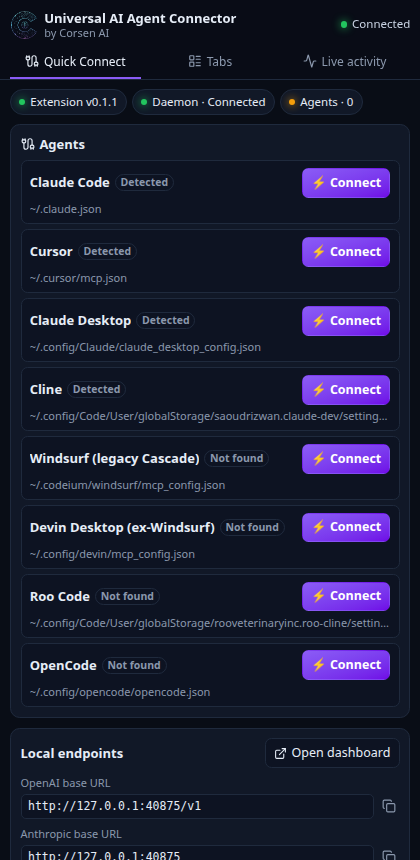
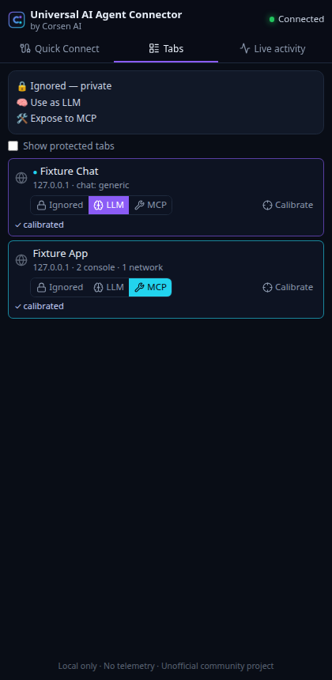
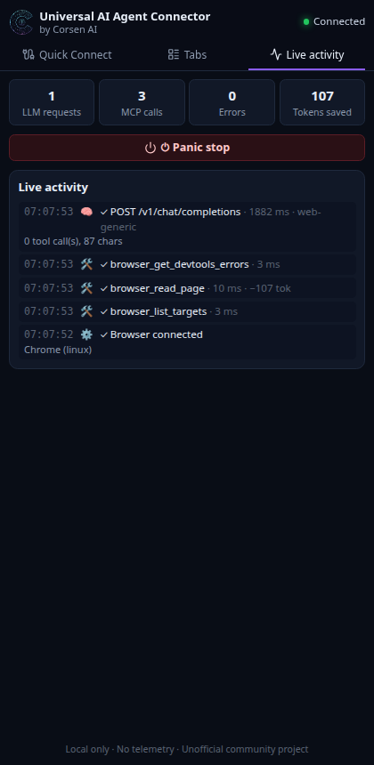
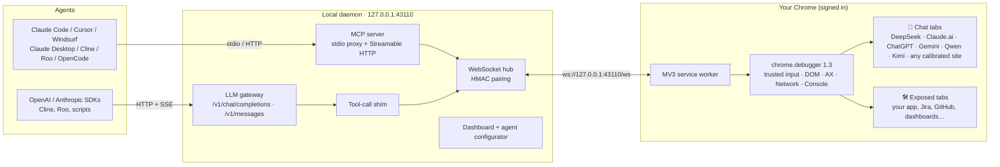
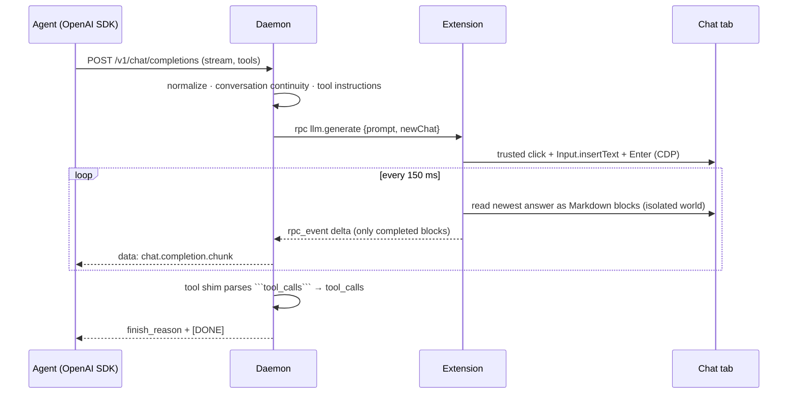
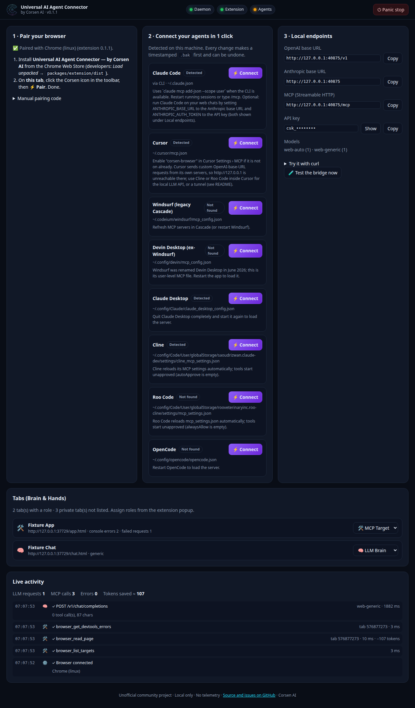

<div align="center">

```
   ______                             ______                            __
  / ____/___  ______________  ____   / ____/___  ____  ____  ___  _____/ /_____  _____
 / /   / __ \/ ___/ ___/ _ \/ __ \ / /   / __ \/ __ \/ __ \/ _ \/ ___/ __/ __ \/ ___/
/ /___/ /_/ / /  (__  )  __/ / / // /___/ /_/ / / / / / / /  __/ /__/ /_/ /_/ / /
\____/\____/_/  /____/\___/_/ /_/ \____/\____/_/ /_/_/ /_/\___/\___/\__/\____/_/
```

# Universal AI Agent Chrome Connector

**Your signed-in web chats become a local OpenAI & Anthropic API. The tabs you choose become MCP tools.<br>One Chrome extension, one tiny local daemon, zero JSON to edit.**

[](LICENSE)
[](https://modelcontextprotocol.io)
[](packages/extension)
[](tsconfig.base.json)
[](packages/daemon)
[](#tests)

by **Corsen AI** · local only · no telemetry · unofficial community project

</div>

---

## Why

AI agents hit two walls:

1. **Agents need a model** — and the chat assistants you already use are open in your browser, signed in.
2. **Agents can't see your real web** — your Jira, GitHub, LinkedIn, internal dashboards live behind
   SSO, 2FA and Cloudflare in *your* signed-in Chrome, not in a headless sandbox.

The connector solves both with one extension:

| | 🧠 **The Brain** | 🛠️ **The Hands** |
|---|---|---|
| What | Your chat tabs become `http://127.0.0.1:43110/v1/chat/completions` and `/v1/messages` | Tabs you expose become a full **MCP server** (stdio + Streamable HTTP) |
| For | Cline, Roo Code, Claude Code (`ANTHROPIC_BASE_URL`), scripts, any OpenAI/Anthropic SDK | Claude Code, Cursor, Windsurf / Devin Desktop, Claude Desktop, Cline, Roo Code, OpenCode |
| How | Prompts are typed with trusted input, answers read back as Markdown and **streamed (SSE)**; function calling is emulated by a **tool-call shim** | Clean Markdown or accessibility tree with `[ref=e12]` handles, trusted clicks/typing, **DevTools error feed**, JSON/GraphQL capture, screenshots |

And a **1-click onboarding**: the daemon detects your agents and writes their MCP config for you —
with a timestamped `.bak` and an **Unlink / Restore** button.

<div align="center">
  
  
  
</div>

---

## 30-second start

Two parts: the **extension**, installed from the Chrome Web Store, and the **daemon**, a small Node.js
program you run from this repository.

**1. Install the extension.** In the Chrome Web Store, install **Universal AI Agent Connector — by
Corsen AI**. (Developers: load `packages/extension/dist` unpacked after `pnpm build`, see
[Development](#development).)

**2. Run the daemon** (Node.js 22 or newer, [pnpm](https://pnpm.io)):

```bash
git clone https://github.com/CorsenAI/universal-ai-agent-chrome-connector.git
cd universal-ai-agent-chrome-connector
pnpm install && pnpm build
pnpm connector
```

The daemon starts on `127.0.0.1:43110` and opens its **dashboard**. `pnpm connector <command>` runs
any CLI command from the checkout (`pnpm connector dashboard`, `pnpm connector token --show`, …),
and the hints the CLI prints use that form too.

**3. Pair.** On the dashboard tab, click the Corsen icon → **⚡ Pair**. Done (the pairing survives
restarts).

**4. Connect your agents** — from the dashboard, the side panel, or the terminal:

```bash
pnpm connector setup
```

**5. Use it.** Open any page → Corsen icon → **🛠️ MCP**. Open a signed-in chat → **🧠 LLM**. Ask your
agent.

---

## How it works





---

## 🛠️ The Hands — MCP tools

| Tool | What the agent gets |
|---|---|
| `browser_list_targets` | Exposed tabs: `target_id`, title, URL, live console / network error counters |
| `browser_read_page` | `markdown` (headings, lists, tables, fenced code, links) with `[ref=eN]` on every control, or `accessibility` (compact interactive tree). Secret fields masked. Far fewer tokens than raw HTML — the saving is measured on every read and shown live |
| `browser_act` | `click` `type` `press_key` `scroll` `select` `hover` `wait_for` `navigate` `reload` `back` `forward` — trusted CDP input (`isTrusted: true`); failures are errors, never fake successes |
| `browser_get_devtools_errors` | `console.error`/warnings, uncaught exceptions, browser log errors, HTTP 4xx/5xx and network failures **with redacted headers and the response body** — perfect for fixing your `localhost:3000` app |
| `browser_capture_network_api` | The page's own JSON / GraphQL calls (operation names, bodies) — read authenticated APIs without re-authenticating |
| `browser_screenshot` | WebP (default), PNG or JPEG, viewport or full page |

Refs are short (`e12`), stable across snapshots, **never reused**: a ref from an older page fails
with `STALE_REF` instead of clicking the wrong thing.

---

## 🧠 The Brain — your web chats as an API

```bash
curl http://127.0.0.1:43110/v1/chat/completions \
  -H "Authorization: Bearer $CORSEN_API_KEY" -H "Content-Type: application/json" \
  -d '{"model":"web-auto","stream":true,"messages":[{"role":"user","content":"Hello!"}]}'
```

- **Models**: `web-auto` (any brain tab), `web-deepseek`, `web-claude`, `web-chatgpt`, `web-gemini`,
  `web-qwen`, `web-kimi`, `web-generic` (calibrated site). Vendor names such as `claude-sonnet-…`,
  `gpt-…`, `deepseek-chat` route to the matching chat when one is open.
- **Endpoints**: `GET /v1/models`, `POST /v1/chat/completions` (JSON or SSE, `stream_options.include_usage`),
  `POST /v1/messages` (JSON or SSE with the documented event sequence), `POST /v1/messages/count_tokens`.
- **Tool calling**: declared tools are injected as instructions; the model answers with a fenced
  `tool_calls` JSON block that survives every chat UI's Markdown renderer; the streaming parser never
  leaks it and returns OpenAI `tool_calls` / Anthropic `tool_use` blocks (names validated).
- **Conversation continuity**: when a request continues the web conversation, only the new turn is
  typed; otherwise a new chat starts with the full transcript.
- **Calibrate any chat in 10 seconds**: Tab Manager → *Calibrate* → click the input, the send button
  and one answer. The site then works as `web-generic`.

| Client | Setup |
|---|---|
| Cline / Roo Code | Provider *OpenAI Compatible* → base URL `http://127.0.0.1:43110/v1`, API key from the dashboard, model `web-auto` |
| Claude Code | `ANTHROPIC_BASE_URL=http://127.0.0.1:43110 ANTHROPIC_AUTH_TOKEN=<API key> claude` |
| OpenAI SDK | `OpenAI(base_url="http://127.0.0.1:43110/v1", api_key=KEY)` |
| Cursor | Cursor sends custom-model requests **from its servers**, so `127.0.0.1` is unreachable from there: use Cline/Roo inside Cursor, or a tunnel started with `--allow-host <tunnel-host>` (the API key stays required) |

---

## ⚡ 1-click agent onboarding

| Agent | What the connector writes | Restart |
|---|---|---|
| Claude Code | `claude mcp add-json --scope user corsen-browser …` (official CLI; its state file, `~/.claude.json` or `$CLAUDE_CONFIG_DIR/.claude.json`, is backed up first) | running sessions: `/mcp` |
| Cursor | `~/.cursor/mcp.json` | no |
| Windsurf (legacy Cascade) | `~/.codeium/windsurf/mcp_config.json` | refresh |
| Devin Desktop (ex-Windsurf, June 2026) | `~/.config/devin/mcp_config.json` (`%APPDATA%\devin\…` on Windows) | yes |
| Claude Desktop | `claude_desktop_config.json` (macOS `~/Library/Application Support/Claude/`, Windows `%APPDATA%\Claude\`, Linux `~/.config/Claude/`) | yes |
| Cline | VS Code-family `globalStorage/saoudrizwan.claude-dev/settings/cline_mcp_settings.json` and/or `~/.cline/data/settings/` | no |
| Roo Code | `globalStorage/rooveterinaryinc.roo-cline/settings/mcp_settings.json` | no |
| OpenCode | `~/.config/opencode/opencode.json(c)` → `mcp.servers` | yes |

Every edit is **comment-preserving** (JSONC), **atomic**, keeps the file mode, writes **through
symlinks** (dotfile managers), refuses to touch a file that does not parse, and makes a timestamped
`*.corsen-backup-YYYYMMDD-HHMMSS.bak` first. **Unlink** removes only our entry; **Restore** puts back
the last backup (the replaced version is backed up too). Approvals stay off: `autoApprove` /
`alwaysAllow` are written empty.

<div align="center"></div>

Agents launch the daemon's `mcp` command (stdio). It speaks both MCP eras (2025 `initialize` and the
2026-07-28 stateless revision) and **starts the daemon in the background if it is not running**.

---

## Security model

Loopback is **not** a trust boundary — every web page in your browser can talk to `127.0.0.1`. So:

- **Private by default.** A tab is *Ignored* until you choose a role: no debugger, no read, no input.
  Agents can never change a role; after a browser restart every tab is Ignored again. A role belongs
  to the tab, not to the site: a site you (or an agent) open later in an exposed tab is exposed too,
  until you set the tab back to Ignored.
- **Visible.** Chrome shows its "is debugging this browser" banner on controlled tabs; cancelling it
  makes the tab private again. **Panic stop** detaches everything in one click.
- **Paired, not trusted.** Extension ⇄ daemon uses mutual, role-bound HMAC-SHA256 over a pairing secret
  that never crosses the wire (the handshake of Corsen AI's Hermes and DeepSeek Harness connectors), and the
  WebSocket only accepts `chrome-extension://` origins.
- **Guarded HTTP.** Host must be loopback (DNS rebinding), any foreign `Origin` is refused (CSRF), the
  API key is required, POST bodies must be JSON. The dashboard uses a one-time login link and an
  `HttpOnly; SameSite=Strict` cookie. Secrets live in `~/.corsen-connector/credentials.json` (0600).
- **Redaction before the trust boundary.** Passwords, one-time codes, card fields, hidden inputs,
  secret URL parameters, credential headers and secret JSON keys are masked in the browser, then
  again in the daemon. Screenshots are pixels: **they are not redacted**.
- **Untrusted pages.** Page text and web-LLM answers are data. Agents can still be prompt-injected by
  what they read — expose only tabs you would let an assistant read.
- **No remote code, no telemetry, no eval** (the build strips Zod's JIT; the Store zip is read back and
  scanned before release). Extension pages load images only from the package (`img-src 'self' data:`),
  and the package carries the license notices of the code it bundles (`THIRD_PARTY_LICENSES.txt`).

Details: [docs/SECURITY-MODEL.md](docs/SECURITY-MODEL.md) · wire protocol: [docs/PROTOCOL.md](docs/PROTOCOL.md) ·
report a vulnerability: [SECURITY.md](SECURITY.md).

> **Terms of service.** Driving a chat service through its web UI may be restricted by that
> service's terms. You are responsible for how you use your own accounts. This project is not
> affiliated with or endorsed by DeepSeek, Anthropic, OpenAI, Google, Alibaba, Moonshot, Cursor,
> Cognition, Cline or Roo Code.

---

## How it compares

| | This connector | Headless automation MCP servers | Raw DevTools-protocol MCP servers | Web-chat → API proxies |
|---|:---:|:---:|:---:|:---:|
| Uses **your** signed-in Chrome (SSO, 2FA, Cloudflare already passed) | ✅ | usually a separate profile | ✅ | ✅ |
| Per-tab opt-in, private by default, panic stop | ✅ | n/a | rarely | n/a |
| Token-lean Markdown / AX tree with stable refs | ✅ | varies | low-level | n/a |
| DevTools error feed + JSON/GraphQL capture | ✅ | varies | ✅ | n/a |
| Web chats as OpenAI **and** Anthropic API, SSE, tool calling | ✅ | ❌ | ❌ | partial |
| 1-click config of 8 agents with backups | ✅ | ❌ | ❌ | ❌ |

---

## Reference

**CLI** (`universal-connector`, alias `corsen-connector`; from the repository checkout, `pnpm connector`): `start` (default) · `mcp` · `setup
[--agent <id>] [--all] [--list]` · `unlink <agent>|--all` · `restore <agent>` · `status [--json]` ·
`token [--show] [--rotate]` · `dashboard` · `stop`. Options: `--port`, `--no-open`, `--allow-host`,
`--allow-origin`, `--log-level`.

**Environment**: `CORSEN_CONNECTOR_PORT` (default 43110), `CORSEN_CONNECTOR_HOME` (default
`~/.corsen-connector`: `credentials.json`, `daemon.log`, `daemon.pid`, `backups.json`).

**Extension permissions** — each one used and justified: `debugger` (CDP on tabs you assign; Chrome
does not allow it as optional), `tabs` (titles/URLs in the tab manager), `sidePanel`, `storage`,
`activeTab` + `scripting` (the popup reads the pairing code of the open dashboard tab when you click
*Pair*), `alarms` (reconnects while the daemon is down). No host permissions, no content scripts.
In the Chrome Web Store the extension is listed as **Universal AI Agent Connector — by Corsen AI**.
Privacy policy: [docs/privacy/index.html](docs/privacy/index.html).

---

## Development

```bash
pnpm install
pnpm build        # shared (typecheck) → daemon (tsdown) → extension (Vite 8)
pnpm connector    # run the built daemon CLI (any command: setup, status, token --show, stop…)
pnpm test         # unit + integration tests (vitest)
pnpm typecheck    # TypeScript 7, every package + e2e
pnpm test:e2e     # real Chromium + built daemon + built extension
pnpm screenshots  # regenerate docs/assets from the real product
pnpm package:extension  # Store zip from a clean commit → release/ (+ SHA-256)
pnpm verify:extension   # read the zip back: byte-for-byte, allowlist, manifest, scripts
pnpm store:assets       # Store screenshots, tiles and icon → store/
```

To work on the extension itself, load the build instead of the Store version: `chrome://extensions` →
*Developer mode* → **Load unpacked** → `packages/extension/dist`.

```
packages/shared     Zod schemas: WebSocket protocol, MCP tool contracts, OpenAI/Anthropic, redaction
packages/daemon     CLI + daemon: Hono, ws, MCP SDK v2, LLM gateway, tool shim, configurator, dashboard
packages/extension  MV3: service worker, chrome.debugger manager, harnesses, distiller, React UI
e2e/                Playwright-driven end-to-end suite and fixtures
store/              Chrome Web Store listing, policy texts and images
```

<a id="tests"></a>**What the tests prove** — protocol parsing and HMAC pairing (wrong secret, wrong
version, foreign origin), Host/Origin/CSRF guards, the tool shim at every streaming split, OpenAI
and Anthropic wire formats, conversation continuity, the configurator on a temporary home (JSONC,
symlinks, backups, the Claude CLI path), the official MCP client negotiating `2025-11-25` **and**
`2026-07-28` over HTTP and stdio, the stdio proxy auto-starting the daemon, the distiller (secrets
masked, refs never reused, code-block chrome of chat UIs ignored), the isolated world recreated when a
page replaces its document, and — in a real browser — trusted clicks on a page that ignores synthetic
ones, the DevTools feed, GraphQL capture, WebP screenshots, the visual picker, streaming chat
completions and tool calls through a web chat (including one that opens a new document on the first
message), and panic stop.

---

## Known limitations

- Built-in chat selectors are best-effort (2026-11): exercised on a fixture chat and on chatgpt.com
  without an account, not on signed-in accounts; recalibrate with the picker if a site changes.
- Images in prompts are replaced by a placeholder; `max_tokens` and sampling parameters are not
  enforced by web chats.
- One active browser at a time (the newest paired browser takes over).
- Verified on Linux (Chrome for Testing 156); macOS and Windows paths are implemented but not yet run.
- The daemon is distributed as source from this repository; there is no npm package yet.

## License

[Apache-2.0](LICENSE) · © 2026 Corsen AI · see [NOTICE](NOTICE) for trademarks.
